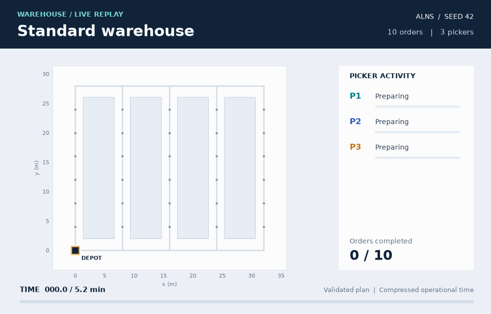
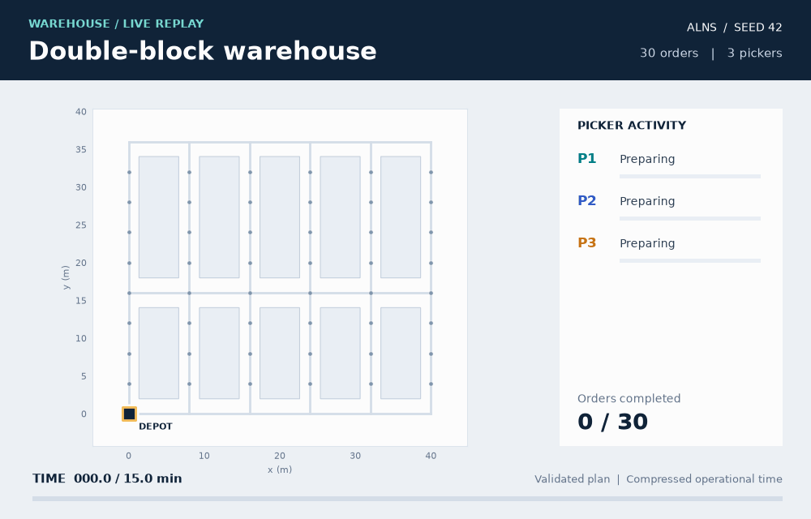
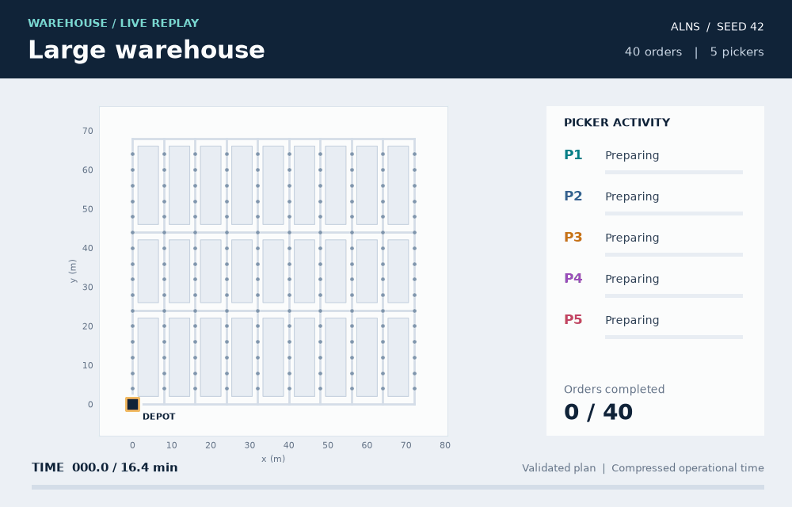
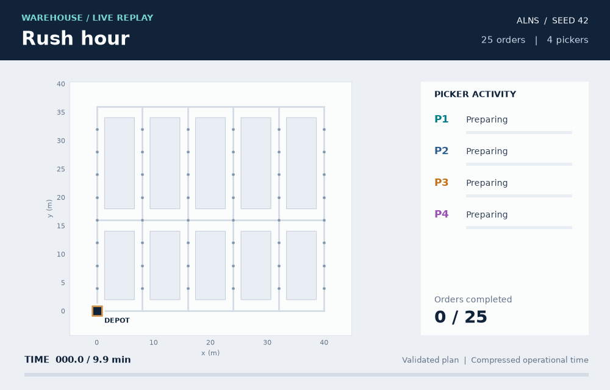
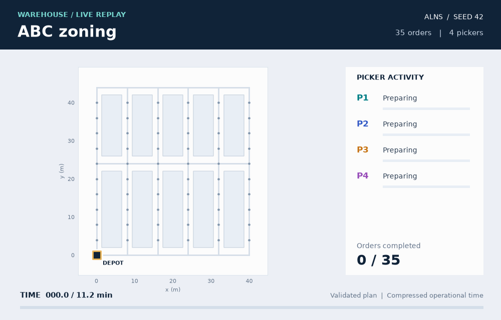
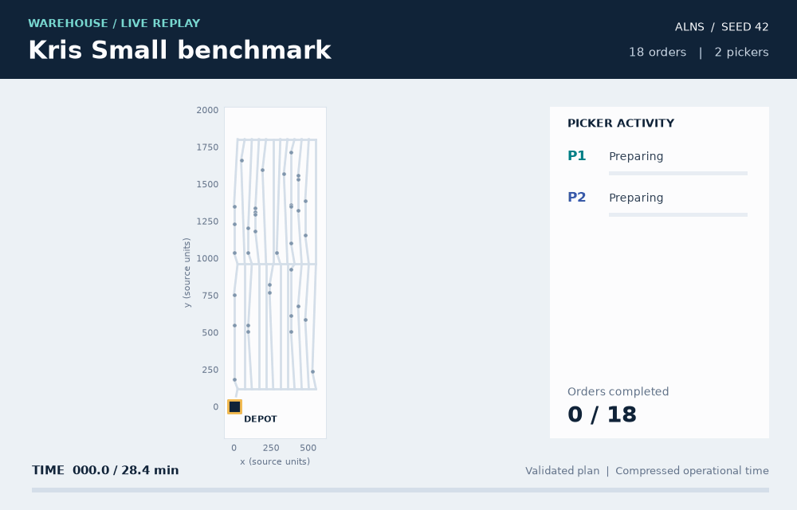

# 📦 Warehouse picking optimization

**Joint order batching, routing and scheduling for multiple warehouse pickers.**

[🇻🇳 Vietnamese](README.md) · [🇬🇧 English](README.en.md)

An **Applied Algorithms** coursework project with a Python solver, a Streamlit simulation and benchmarks for **B0, B2, LNS, ALNS and VNS**.

## 🎬 Watch the warehouses in action
### 🏭 Standard warehouse

5 aisles × 6 rows, 30 SKUs, 10 orders, 3 pickers, capacity 20.



### 🏗️ Double-block warehouse

6 aisles × 8 rows, 48 SKUs, one internal cross aisle, 30 orders, 3 pickers, capacity 25.



### 🏢 Large warehouse

10 aisles × 16 rows, 160 SKUs, two internal cross aisles, 40 orders, 5 pickers, capacity 30.



### ⚡ Rush hour

The double-block layout with 25 orders, 4 pickers, capacity 20 and due-date slack coefficient 0.06.



### 🎯 ABC zoning

6 aisles × 10 rows, 60 SKUs, 35 orders, 4 pickers, capacity 25. The closest 20% of SKUs receive 70% of the demand sampling weight; this is not an observed real-world proportion.



### 🗺️ Kris Small

Input `instances_100_1`: 18 orders, 35 SKUs, 72 nodes and 2 pickers. The GIF retains source coordinates; the clock converts source time to minutes using the project's display convention (source time divided by 1,800). Connections are graph edges, not inferred storage racks.



GIFs show picker IDs at their positions, recent movement trails, preparation/travel/picking states, capacity-relative load bars, completed orders and playback progress. A halo highlights active picking; pickers can overlap at the depot because the model does not handle collisions.

## 🚀 Installation

Requires **Python 3.10 or later**. Run from the project root:

```console
python -m venv .venv
```

Windows:

```console
.\.venv\Scripts\python.exe -m pip install -r requirements.txt
.\.venv\Scripts\python.exe -m streamlit run demo/app.py
```

Linux/macOS:

```console
source .venv/bin/activate
python -m pip install -r requirements.txt
python -m streamlit run demo/app.py
```

If Conda `TTUD` exists, run `conda activate TTUD`, install requirements and launch Streamlit. The demo defaults to [localhost:8501](http://localhost:8501). Subsequent commands use the installed environment's Python; Windows users can substitute `.\.venv\Scripts\python.exe` for `python`.

## 🖥️ Using the demo

1. Select **Simulation** in the sidebar.
2. Choose synthetic data, Kris data or upload JSON.
3. Select a layout, order count, pickers and capacity.
4. Enable **Compare 5 algorithms** if needed; B0 and ALNS run by default.
5. Click **Run optimization** and inspect the result tabs.

| Tab | Contents |
|---|---|
| Simulation | Replay, adjust speed, seek and select pickers. |
| Overview | Distance, makespan, late orders and F. |
| Routes and schedule | Batch routes and picker schedules. |
| Details | Batches, orders and items. |
| Evaluation | Comparisons within the current run. |

Under **Advanced**, adjust the seed, budget, weights, guided candidate selection and incremental candidate validation. Rerun after changing inputs; switching tabs does not rerun optimization.

For multiple instances and seeds, select **Benchmark evaluation**, open `evaluation.json`, and select a data group and reference algorithm. CSV and PNG downloads are available. Evaluation packages include inputs and solutions for validation on another machine.

## 🧠 Model and algorithms

Each order belongs to exactly one batch, whose load respects capacity. Batches start and end at the depot and travel on the warehouse graph. Each picker executes batches sequentially; orders complete when their batch returns to the depot.

| Method | Mechanism |
|---|---|
| B0 | Sequential batching, nearest-neighbor routing and fixed scheduling rules. |
| B2 | Greedy batching with 2-opt route improvement. |
| LNS | Destroy part of a solution and repair it. |
| ALNS | Adapt operator selection probabilities using search performance. |
| VNS | Change neighborhoods involving orders, batches and schedules. |

**F** combines distance, makespan and total tardiness, normalized using B0. **Lower F is better for the same input and weights.** Due dates are soft; reducing total tardiness does not guarantee fewer late orders. Orders are available at time 0, pickers are homogeneous, and collisions and breaks are not modeled.

The solver retains Kris source units. The interface converts 10 source distance units to 1 m, with time scaled consistently to a speed of 60 m/min. This is a display convention without real-world calibration; JSON retains source data.

## ⌨️ Command line

```console
python -m src generate --scenario double_block --orders 20 --pickers 4 --capacity 30 --seed 42 --output data/synthetic/example.json
python -m src solve data/synthetic/example.json --method ALNS --seconds 3 --iterations 100000 --seed 42 --output results/example/solution.json
python -m src validate data/synthetic/example.json results/example/solution.json
```

Use `--profile balanced`, `distance`, `makespan`, `tardiness`, or `--weights` with three positive weights summing to 1. The `--candidate-policy guided --incremental-validation` variant does not guarantee better performance on every instance.

For iteration-based reproducibility, use `--seconds 0 --iterations 200` with the same input, seed and configuration. Time budgets depend on machine load. The `exact` solver supports at most 6 orders and 8 non-depot item locations; optimality is certified only when `certified_optimal=true`.

```console
python -m src --help
python -m src solve --help
python -m src exact --help
```

## 📊 Benchmarking

Configuration: [configs/benchmark.json](configs/benchmark.json).

| Group | Scope |
|---|---|
| `maps` | Five synthetic warehouse scenarios. |
| `scalability` | Increasing order counts with a fixed warehouse configuration. |
| `kris` | 18 Kris Small instances with 6, 12 and 18 orders. |

Check configuration, run a quick experiment and run the full preset:

```console
python -m src benchmark --config configs/benchmark.json --preset report --groups maps scalability kris --dry-run
python -m src benchmark --config configs/benchmark.json --preset quick --groups maps scalability --output results/benchmark_quick_01 --presentation
python -m src benchmark --config configs/benchmark.json --preset report --groups maps scalability kris --output results/benchmark_report_02 --presentation
```

The current report preset includes 45 main instances, 1,440 main runs and 765 budget/weight sensitivity runs, totaling 2,205 runs. B0/B2 run once per instance; LNS/ALNS/VNS use 10 seeds with a 3-second initialization-and-search budget per main run. Additional report studies run separately; the command above does not generate all 2,475 results in the report.

Kris requires the catalog and converted JSON files; see the [data guide](data/README.md). Without them, use `--groups maps scalability`. Use a new or empty directory for each experiment. Add `--resume` to reuse completed, validated groups; incomplete groups restart from the beginning.

Regenerate figures and tables from saved results without rerunning search:

```console
python -m src report --input results/benchmark_report_02 --output results/benchmark_png_02/report --presentation
```

| Output in the benchmark's `report/` directory | Purpose |
|---|---|
| `index.html`, `REPORT.md` | Figure catalog and interpretation guide. |
| `summary.csv`, `per_instance.csv` | Group and per-instance summaries. |
| `raw_metrics.csv`, `sensitivity.csv` | Per-run metrics and sensitivity studies. |
| `figures_report/`, `figures_presentation/` | PNGs for reports and slides; no PowerPoint file is generated. |
| `evaluation.json` | Package to open in the demo. |

Average seeds within each instance before aggregating across a group. Standard deviations are not confidence intervals. The maps group changes multiple factors simultaneously; use scalability to study order counts. Do not directly rank F values with different weights.

## 📚 Structure and documentation

```text
demo/             Interface and dynamic replay
src/              Model, solvers, validation, benchmarks and exports
configs/          Experiment configurations
data/             Source, synthetic and converted data
assets/readme/    GIFs and configuration metadata
scripts/          Supporting tools
tests/            Tests
report/           LaTeX report and PDF
results/          Generated results, Git-ignored
```

- [Data sources and preparation](data/README.md)
- [Report PDF](report/T%E1%BB%91i%20%C6%B0u%20h%C3%B3a%20%C4%91a%20m%E1%BB%A5c%20ti%C3%AAu%20quy%20tr%C3%ACnh%20l%E1%BA%A5y%20h%C3%A0ng%20trong%20kho%20h%C3%A0ng.pdf)
- [Report source](report/main.tex)